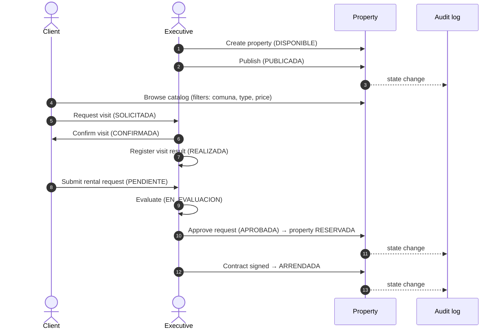
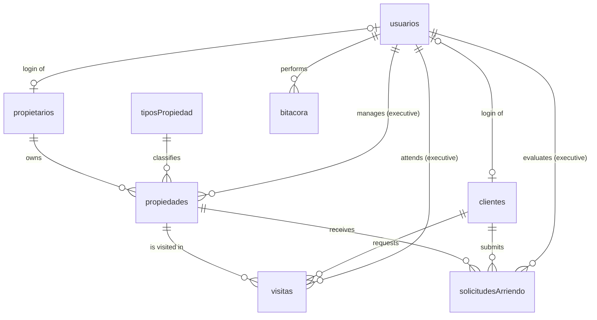
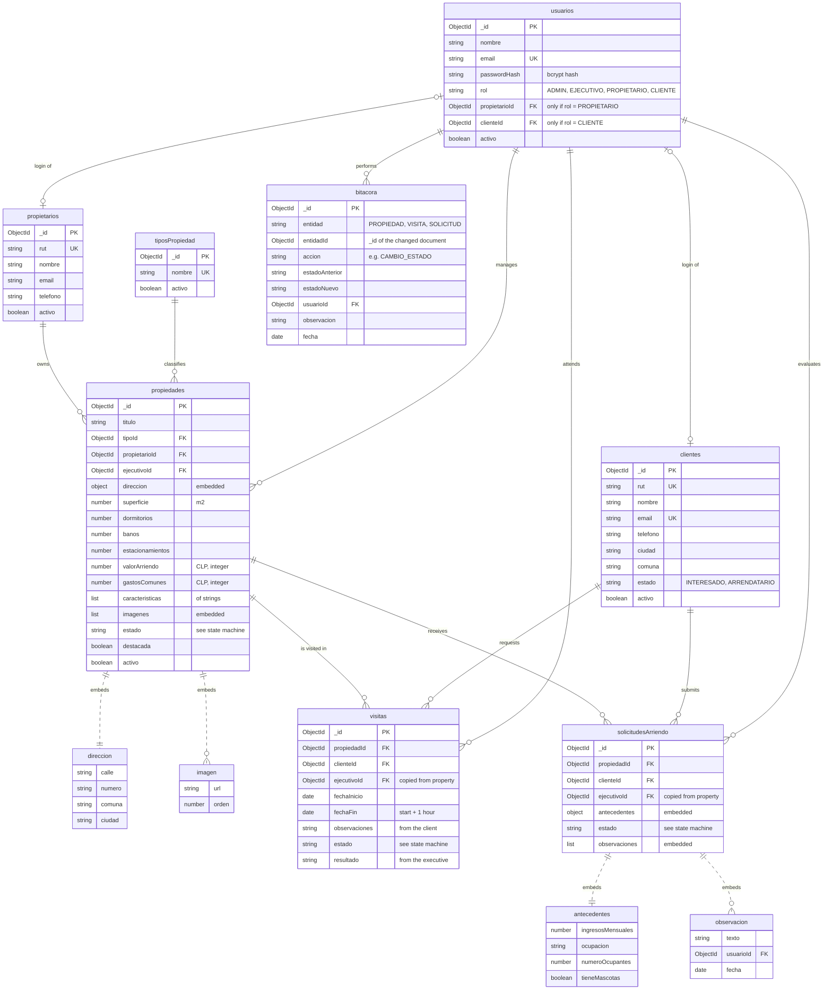
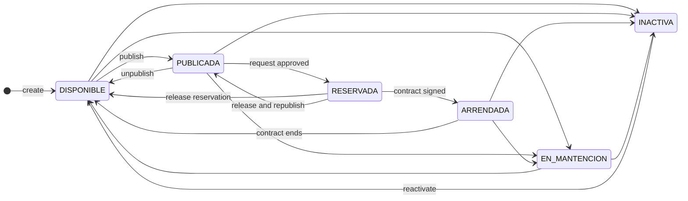
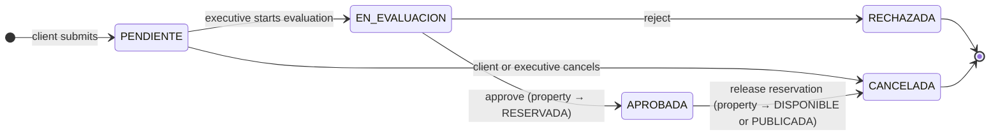
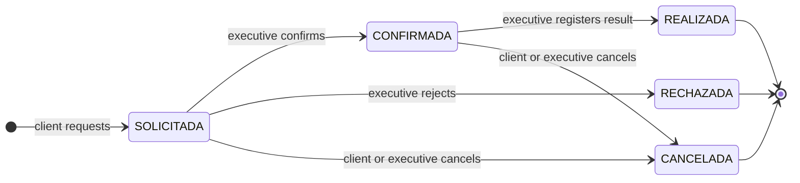

# Data model

This document describes the MongoDB data model for GUP: the collections, how they relate, the states each entity goes through, and the business rules that the backend enforces. Each section explains the decision **and why** it was made, so anyone on the team can write a schema without guessing.

It is based on the case specification ([`Caso3_GestionInmobiliaria_Especificaciones.md`](Caso3_GestionInmobiliaria_Especificaciones.md)). References like **RF4**, **RN-14** or **RNF-10** point to its requirements and rules.

> **Status:** proposal for the first backend milestone. The points in [Open questions](#11-open-questions) still need to be confirmed with the professor.

---

## Contents

1. [MongoDB in five minutes](#1-mongodb-in-five-minutes)
2. [The business in one picture](#2-the-business-in-one-picture)
3. [Collections overview](#3-collections-overview)
4. [Design decisions](#4-design-decisions)
5. [Collections in detail](#5-collections-in-detail)
6. [State machines](#6-state-machines)
7. [Business rules and where they are enforced](#7-business-rules-and-where-they-are-enforced)
8. [Indexes](#8-indexes)
9. [Where this lives in the backend](#9-where-this-lives-in-the-backend)
10. [Postman demo plan](#10-postman-demo-plan)
11. [Open questions](#11-open-questions)

---

## 1. MongoDB in five minutes

| SQL | MongoDB | Meaning |
|---|---|---|
| Database | Database | Ours is `real_estate` |
| Table | **Collection** | A group of records of the same kind: `propiedades`, `visitas`... |
| Row | **Document** | One record, stored as a JSON-like object |
| Primary key | **`_id`** | MongoDB creates it automatically in every document (an *ObjectId*) |
| Foreign key | **Reference** | A field that stores the `_id` of another document, for example `propietarioId` |
| `JOIN` | **`populate()`** | Mongoose replaces a reference with the full document when you ask for it |

Two ideas that don't exist in SQL drive the whole design:

- **Embed or reference.** A document can hold other data **inside it** (the list of photos inside a property), or only the **`_id`** of another document (a property stores the `_id` of its owner). Rule of thumb: **embed** what belongs only to that document and is always read with it; **reference** what has a life of its own or is queried on its own.
- **Mongoose schemas.** MongoDB accepts any shape of document. **Mongoose** (already installed in `backend/`) adds a **schema** per collection: which fields exist, their types, which ones are required and which values are allowed. The schema is where most validations live.

---

## 2. The business in one picture

An **owner** hands properties over to the company. An **executive** manages and publishes them. A **client** browses the catalog, asks for a **visit**, and if they like the property, submits a **rental request**. The executive evaluates it and, if approved, the property is **reserved** until the contract is signed and it becomes **rented**. Every state change is written to an **audit log** (*bitácora*).



This end-to-end flow (spec §7) is what the professor expects to see working: **consulta → visita → solicitud → evaluación → reserva**.

---

## 3. Collections overview

**8 collections.** Solid lines are **references** (a field storing another document's `_id`). The detailed diagram in [section 5](#5-collections-in-detail) also shows the **embedded** parts.



| Collection | What it stores | Spec |
|---|---|---|
| `usuarios` | Login accounts and roles | RF1, RF2 |
| `propietarios` | Property owners (business data) | RF3 |
| `clientes` | Interested clients and tenants | RF6 |
| `tiposPropiedad` | Catalog of property types | RN-E |
| `propiedades` | Properties, with address and images embedded | RF4, RF5 |
| `visitas` | Visit requests and their outcome | RF7, RF8 |
| `solicitudesArriendo` | Rental requests, with evaluation notes embedded | RF9, RF10, RF11 |
| `bitacora` | Audit log of every state change | RNF-12 |

How to read the symbols: `||` exactly one, `o{` zero or many, `|o` zero or one. For example, `propietarios ||--o{ propiedades` means *one owner has zero or many properties, and each property has exactly one owner*.

---

## 4. Design decisions

### D1. Separate the **account** from the **person**

`usuarios` holds the login (email, password hash, role). `propietarios` and `clientes` hold the business data (RUT, phone, status).

**Why:** the spec says the executive registers **interested clients** who call by phone (RF6). Those people **don't have an account** yet. If everything lived in `usuarios`, we couldn't register someone without a password. When a person does have an account, the user stores a reference to their record (`propietarioId` or `clienteId`).

### D2. Admins and executives are just users with a role

They don't get their own collection.

**Why:** they have no extra business data. A property's `ejecutivoId` points to a document in `usuarios` whose `rol` is `EJECUTIVO`.

### D3. Address and images are **embedded** in the property

**Why:** an address and a photo only exist for that one property, and they are always shown together with it. Embedding means one query returns the whole card. The spec asks for "images (or references)", so storing the image **URL** inside the property is enough.

### D4. Property types get their **own collection**

**Why:** the spec asks to be able to add new types later (RN-E). If the types were a fixed list in the code, adding one would mean changing and redeploying the code. With a collection, the admin just inserts a document.

### D5. Prices are **numbers**, not text

`valorArriendo: 680000`, never `"$680.000"`.

**Why:** the catalog filters by price range (RF5), and you can't compare text as numbers (`"$90.000" > "$680.000"` is true as text). The frontend adds the `$` and the dots when it displays the value.

### D6. Nothing is physically deleted (soft delete)

Every main collection has an `activo: true/false` field. "Delete" sets it to `false`.

**Why:** RNF-10 / RN-17. If an owner were really deleted, their properties, visits and requests would point to an `_id` that no longer exists, and the history would break.

### D7. A reservation is **not** a collection

A reservation is **a property in state `RESERVADA` + one rental request in state `APROBADA`**.

**Why:** a separate `reservas` collection would duplicate that information, and the copies could get out of sync (a reservation saying "active" while the property is already `ARRENDADA`). The `/reservas` endpoints in the spec still exist; they just change those two documents.

### D8. Visits have a fixed **duration of 1 hour**

We store `fechaInicio` and `fechaFin` (= start + 1 hour).

**Why:** to detect overlapping visits (RN-10) we need to know when a visit **ends**. With both dates, "do these two visits overlap?" is one simple comparison: `A.start < B.end` **and** `B.start < A.end`.

### D9. States are stored as **UPPERCASE constants**

`DISPONIBLE`, `EN_MANTENCION`, `EN_EVALUACION`... never `"En mantención"`.

**Why:** no accents, spaces or capitalization differences that break comparisons (`"En mantención" !== "En mantencion"`). The frontend translates each constant into a readable label.

### D10. Executive and audit data are **copied** onto visits and requests

When a visit or request is created, the backend copies the property's `ejecutivoId` onto it.

**Why:** the overlap check searches visits **by executive**. If the executive were only on the property, every check would need to look up the property first. It also keeps the history correct if the property is later reassigned to another executive.

### D11. Collection names are set **explicitly**

Mongoose turns a model name into a collection name by pluralizing it **in English**: a model called `Propiedad` would create a collection called `propiedads`. Each schema sets its collection name explicitly (`propiedades`, `solicitudesArriendo`...) so the names in this document are the ones you see in Compass.

### D12. Timestamps come for free

Every schema uses Mongoose's `timestamps` option, which adds `createdAt` and `updatedAt` automatically. They are not listed in the tables below.

---

## 5. Collections in detail

### Full diagram

`PK` = primary key, `FK` = reference to another collection, `UK` = unique. Dashed lines (`..`) are **embedded** objects: they live **inside** the parent document, not in a collection of their own.



### `usuarios`: login accounts

| Field | Type | Required | Notes |
|---|---|:-:|---|
| `nombre` | String | ✔ | |
| `email` | String | ✔ | **Unique**, stored in lowercase |
| `passwordHash` | String | ✔ | Hashed with bcrypt. **Never** the plain password, and never returned by the API |
| `rol` | String | ✔ | `ADMIN`, `EJECUTIVO`, `PROPIETARIO`, `CLIENTE` |
| `propietarioId` | ObjectId → `propietarios` | | Only when `rol` is `PROPIETARIO` |
| `clienteId` | ObjectId → `clientes` | | Only when `rol` is `CLIENTE` |
| `activo` | Boolean | | Default `true` |

**Why the extra ids:** they let the backend know, right after login, *which owner* or *which client* the user is. That is what makes "an owner only sees their own properties" (RNF-07) a simple filter.

### `propietarios`: property owners

| Field | Type | Required | Notes |
|---|---|:-:|---|
| `rut` | String | ✔ | **Unique**. Stored normalized, without dots: `12345678-9` |
| `nombre` | String | ✔ | |
| `email` | String | ✔ | |
| `telefono` | String | | |
| `activo` | Boolean | | Default `true` |

**Private data:** an owner's contact data **never** appears in the public catalog (RNF-08).

### `clientes`: interested clients and tenants

| Field | Type | Required | Notes |
|---|---|:-:|---|
| `rut` | String | ✔ | **Unique**, normalized like in `propietarios` |
| `nombre` | String | ✔ | |
| `email` | String | ✔ | **Unique** |
| `telefono` | String | | |
| `ciudad`, `comuna` | String | | The register form already asks for them |
| `estado` | String | | `INTERESADO` (default) or `ARRENDATARIO` |
| `activo` | Boolean | | Default `true` |

**Why unique RUT and email:** RN-11 forbids registering the same client twice. A unique index makes MongoDB itself reject the duplicate, even if two executives register the same person at the same time.

**Why `estado`:** when a rental is completed, the client becomes `ARRENDATARIO` and can see their rental information (RN-F).

### `tiposPropiedad`: property types

| Field | Type | Required | Notes |
|---|---|:-:|---|
| `nombre` | String | ✔ | **Unique**: Departamento, Casa, Oficina, Local comercial... |
| `activo` | Boolean | | Default `true` |

### `propiedades`: the center of the model

| Field | Type | Required | Notes |
|---|---|:-:|---|
| `titulo` | String | ✔ | The short line on the card, e.g. `Av. Los Leones 1240` |
| `tipoId` | ObjectId → `tiposPropiedad` | ✔ | |
| `propietarioId` | ObjectId → `propietarios` | ✔ | Every property has an owner (RN-D) |
| `ejecutivoId` | ObjectId → `usuarios` | ✔ | The executive in charge (RN-15) |
| `direccion` | Embedded object | ✔ | `{ calle, numero, comuna, ciudad }`. `comuna` is the main catalog filter |
| `superficie` | Number | ✔ | Square meters |
| `dormitorios` | Number | | Shown as "Privados" for offices |
| `banos` | Number | | |
| `estacionamientos` | Number | | |
| `valorArriendo` | Number | ✔ | Monthly rent in CLP, integer |
| `gastosComunes` | Number | | Monthly common expenses in CLP |
| `caracteristicas` | Array of String | | `["piscina", "bodega"]` |
| `imagenes` | Array of embedded objects | | `[{ url, orden }]`. `orden` decides which one is the cover |
| `estado` | String | ✔ | Default `DISPONIBLE`. See [6.1](#61-property) |
| `destacada` | Boolean | | Default `false`. Feeds the "Destacados" block on the landing page |
| `activo` | Boolean | | Default `true` |

**Why `estado` and `activo` are different things:** `estado` is the **business** situation of the property (is it available? rented?). `activo` only says whether the record was **deleted**. A property can be `INACTIVA` (temporarily off the market) and still be `activo: true`.

### `visitas`: visit requests

| Field | Type | Required | Notes |
|---|---|:-:|---|
| `propiedadId` | ObjectId → `propiedades` | ✔ | The property must be `PUBLICADA` (RN-16) |
| `clienteId` | ObjectId → `clientes` | ✔ | |
| `ejecutivoId` | ObjectId → `usuarios` | ✔ | Copied from the property ([D10](#d10-executive-and-audit-data-are-copied-onto-visits-and-requests)) |
| `fechaInicio` | Date | ✔ | Must be in the future |
| `fechaFin` | Date | ✔ | Calculated: `fechaInicio` + 1 hour ([D8](#d8-visits-have-a-fixed-duration-of-1-hour)) |
| `observaciones` | String | | Written by the client when requesting |
| `estado` | String | ✔ | Default `SOLICITADA`. See [6.3](#63-visit) |
| `resultado` | String | | Written by the executive after the visit (RF8) |

**Why `visitas` is its own collection** and not embedded in the property: visits are queried **by executive** (agenda, overlap check) and **by client** ("my visits"), not only by property. A property can also accumulate many visits over time.

### `solicitudesArriendo`: rental requests

| Field | Type | Required | Notes |
|---|---|:-:|---|
| `propiedadId` | ObjectId → `propiedades` | ✔ | Must exist (RN-12) |
| `clienteId` | ObjectId → `clientes` | ✔ | Must exist (RN-12) |
| `ejecutivoId` | ObjectId → `usuarios` | ✔ | Copied from the property |
| `antecedentes` | Embedded object | ✔ | `{ ingresosMensuales, ocupacion, numeroOcupantes, tieneMascotas }`. The spec doesn't define them; this is our proposal |
| `estado` | String | ✔ | Default `PENDIENTE`. See [6.2](#62-rental-request) |
| `observaciones` | Array of embedded objects | | `[{ texto, usuarioId, fecha }]`. The executive's evaluation notes (RF10) |

**Why the notes are embedded:** they only make sense inside their request and are always read with it. An array lets the executive add several notes during the evaluation without losing the earlier ones.

### `bitacora`: audit log

| Field | Type | Required | Notes |
|---|---|:-:|---|
| `entidad` | String | ✔ | `PROPIEDAD`, `VISITA`, `SOLICITUD` |
| `entidadId` | ObjectId | ✔ | `_id` of the document that changed |
| `accion` | String | ✔ | `CREACION`, `CAMBIO_ESTADO`, `RESERVA`, `LIBERACION_RESERVA`... |
| `estadoAnterior` | String | | Empty when the document was just created |
| `estadoNuevo` | String | | |
| `usuarioId` | ObjectId → `usuarios` | ✔ | Who made the change |
| `observacion` | String | | |
| `fecha` | Date | ✔ | Default: now |

**Why a separate collection** and not an array inside each property: it covers **three** kinds of documents, the log only grows, and the professor may want to see "everything that happened today" across all of them. `entidad` + `entidadId` together say which document the entry belongs to.

**Why entries are never edited:** an audit log that can be changed proves nothing. The backend only **inserts** into `bitacora`; there are no update or delete endpoints for it.

---

## 6. State machines

Any transition **not drawn** in these diagrams is rejected by the backend with **`409 Conflict`** and a clear message (RN-03, RNF-09, RNF-14).

### 6.1 Property

Based on spec §6.5.



Two rules come straight from this diagram:

- **Only `DISPONIBLE` can become `PUBLICADA`** (RN-01). A property coming back from maintenance or from being inactive goes through `DISPONIBLE` first.
- **`RESERVADA` is only reached by approving a request**, never by editing the property directly. `PATCH /propiedades/:id/estado` rejects `RESERVADA` as a target; only `PATCH /solicitudes/:id/aprobar` can produce it.

The public catalog shows **only `PUBLICADA` properties** with `activo: true` (RN-02).

### 6.2 Rental request

Based on spec §6.6.



Approving and cancelling an approved request change **two documents** (the request and the property), plus a `bitacora` entry for each.

### 6.3 Visit

Based on spec §6.7.



**"Modify" a visit** (RF7) is not a state: it means changing `fechaInicio`/`fechaFin` while the visit is `SOLICITADA` or `CONFIRMADA`. The new time goes through the overlap check again.

---

## 7. Business rules and where they are enforced

There are three places a rule can live. From strongest to weakest:

1. **Index in MongoDB**: the database itself refuses the operation. Safe even with two requests at the same time.
2. **Mongoose schema**: types, required fields, allowed values (`enum`), defaults.
3. **Backend logic** (controller or service): rules that need to read other documents first.

| Rule | Spec | Where | How | Error |
|---|---|---|---|---|
| Required fields, types, allowed states | RNF-09 | Schema | `required`, `enum`, `min` | `400` |
| No duplicate email in `usuarios` | RF2 | Index | Unique index on `email` | `409` |
| No duplicate client (RUT or email) | RN-11 | Index | Unique indexes on `rut` and `email` | `409` |
| Only allowed property transitions | RN-03 | Backend | Table of allowed transitions from [6.1](#61-property) | `409` |
| Only `DISPONIBLE` → `PUBLICADA` | RN-01 | Backend | Same transition table | `409` |
| Catalog hides reserved and rented properties | RN-02 | Backend | Catalog query filters `estado: PUBLICADA, activo: true` | — |
| Visits only on published properties | RN-16 | Backend | Read the property before creating the visit | `409` |
| No overlapping visits for one executive | RN-10 | Backend | Search a visit of the same executive, not `CANCELADA`/`RECHAZADA`, where `start < newEnd` and `end > newStart` | `409` |
| Only one approved request per property | RN-14 | **Index** + backend | Partial unique index (see [8](#8-indexes)) | `409` |
| Approving reserves the property | RN-04 | Backend | Request → `APROBADA` and property → `RESERVADA` | — |
| Request references existing client and property | RN-12 | Backend | Look both up before saving | `404` |
| Every state change is logged | RN-13 | Backend | Insert into `bitacora` after each change | — |
| An owner only sees their own properties | RNF-07 | Backend | Always filter by the logged-in user's `propietarioId` | `403` / `404` |
| Owner data is not public | RNF-08 | Backend | The catalog never populates or returns `propietarioId` | — |
| Each role only reaches its endpoints | RF2 | Backend | Auth middleware checks the JWT and the `rol` | `401` / `403` |
| Delete = deactivate | RN-17 | Backend | `DELETE` sets `activo: false` | — |

### Why the "one approved request" rule needs an index

The spec asks for the check to be **atomic** (RN-14). If the backend only did "look for an approved request, and if there is none, approve this one", two executives approving at the same instant could both see "none" and both approve. A **unique index** makes MongoDB itself refuse the second write, no matter how close in time they are.

---

## 8. Indexes

An **index** is like the index of a book: it makes searches fast. A **unique** index also forbids repeated values. A **partial** index only applies to documents that match a condition.

| Collection | Index | Type | Why |
|---|---|---|---|
| `usuarios` | `{ email: 1 }` | Unique | Login by email, no duplicate accounts |
| `propietarios` | `{ rut: 1 }` | Unique | No duplicate owners |
| `clientes` | `{ rut: 1 }` | Unique | RN-11 |
| `clientes` | `{ email: 1 }` | Unique | RN-11 |
| `tiposPropiedad` | `{ nombre: 1 }` | Unique | No duplicate types |
| `propiedades` | `{ estado: 1, "direccion.comuna": 1, tipoId: 1, valorArriendo: 1 }` | Compound | Fast catalog filters (RNF-04) |
| `propiedades` | `{ propietarioId: 1 }` | Normal | "My properties" for owners |
| `visitas` | `{ ejecutivoId: 1, fechaInicio: 1, fechaFin: 1 }` | Compound | Fast overlap check and executive agenda |
| `solicitudesArriendo` | `{ propiedadId: 1 }` where `estado = "APROBADA"` | **Partial unique** | Only one approved request per property (RN-14) |
| `bitacora` | `{ entidad: 1, entidadId: 1, fecha: -1 }` | Compound | History of one document, newest first |

`1` means ascending order and `-1` descending.

---

## 9. Where this lives in the backend

There is no separate `database/` folder: everything lives in `backend/`.

```
backend/src/
├── models/        One file per collection: Usuario.js, Propietario.js, Cliente.js,
│                  TipoPropiedad.js, Propiedad.js, Visita.js,
│                  SolicitudArriendo.js, Bitacora.js
├── controllers/   Logic of each endpoint, including the business rules
├── routes/        URLs of each endpoint
├── middlewares/   Authentication (JWT) and role checks
└── fixtures/      Test data to load into the database
```

### Fixtures

**Fixtures** are a script plus a set of sample documents that **empty the database and fill it again** with known data. They are used while testing the CRUD and the business rules in Postman, so nobody has to create data by hand every time and everyone on the team tests against the same data.

They should include at least:

| Data | Amount | Why |
|---|---|---|
| Users | 1 per role (admin, executive ×2, owner, client) | Log in with each role in Postman. Two executives to test reassignment and the overlap rule |
| Property types | 4 | Departamento, Casa, Oficina, Local comercial |
| Owners | 2–3 | To show that each owner only sees their own properties |
| Clients | 3 | One with an account, others registered by phone |
| Properties | ~10 | At least one in **each state**, in several comunas and price ranges |
| Visits | 2–3 | One `CONFIRMADA`, to test the overlap rule against it |
| Rental requests | 2 | One `PENDIENTE`, ready to approve during the demo |

The test users' passwords go in the fixtures README, never real ones.

---

## 10. Postman demo plan

One Postman collection, saved in the repo, that tells the story in order. Each step shows a **happy path** and a **rule violation**:

| # | As | Happy path | Rule violation | Expected error |
|---|---|---|---|---|
| 1 | Executive | Log in, create a property, publish it | Move a `DISPONIBLE` property to `ARRENDADA` | `409` |
| 2 | Anyone | Browse the catalog filtering by comuna and price | A reserved property doesn't appear | — |
| 3 | Client | Request a visit; executive confirms it | Another visit for the same executive at the same time | `409` |
| 4 | Client | Submit a rental request; executive approves it, property becomes `RESERVADA` | Approve a second request for the same property | `409` |
| 5 | Executive | Release the reservation, property back to `PUBLICADA` | — | — |
| 6 | Owner | List their own properties | Ask for another owner's property | `403` |
| 7 | Executive | Register a client | Register the same RUT again | `409` |
| 8 | Admin | Show the `bitacora` with every change of the demo | Call an admin endpoint without a token | `401` |

---

## 11. Open questions

The spec leaves some points open (§13). These are our proposals, to confirm with the professor before writing the schemas:

| Question | Proposal |
|---|---|
| How long does a visit last? | 1 hour, fixed |
| Which background data does a rental request need? | Monthly income, occupation, number of occupants, pets |
| Who creates the accounts? | Clients register themselves (the register page already exists). Owners and executives are created by the admin |
| How is an executive assigned to a property? | Manually, when the property is created |
| Image limits? | JPG, PNG or WebP, up to 2 MB each, up to 10 per property. For this milestone we only store URLs |
| Contracts, payments and maintenance requests? | Out of scope for this milestone. They can be added later as simple collections for the reports (RF12) |
| What happens to other open requests when one is approved? | They stay as they are; approving one of them fails with `409` while the reservation is active. When the property becomes `ARRENDADA`, they are moved to `RECHAZADA` |
